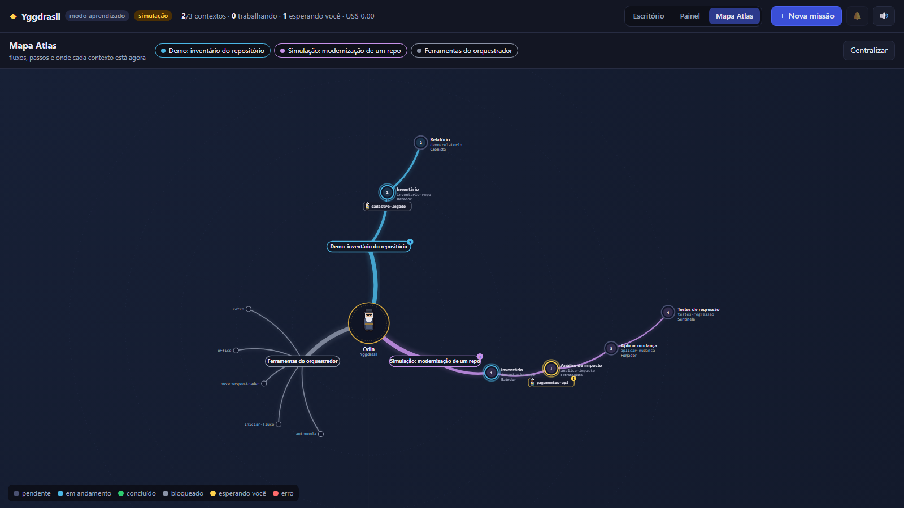
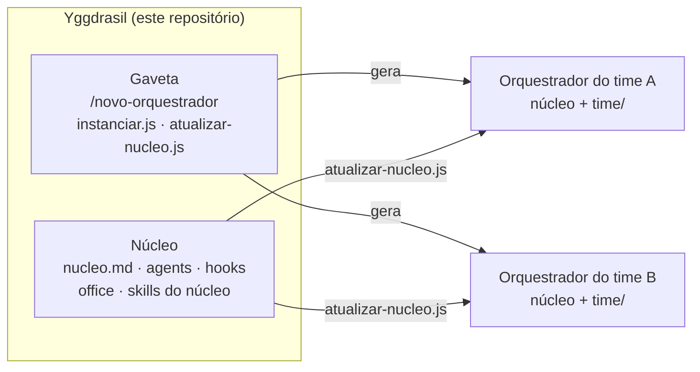
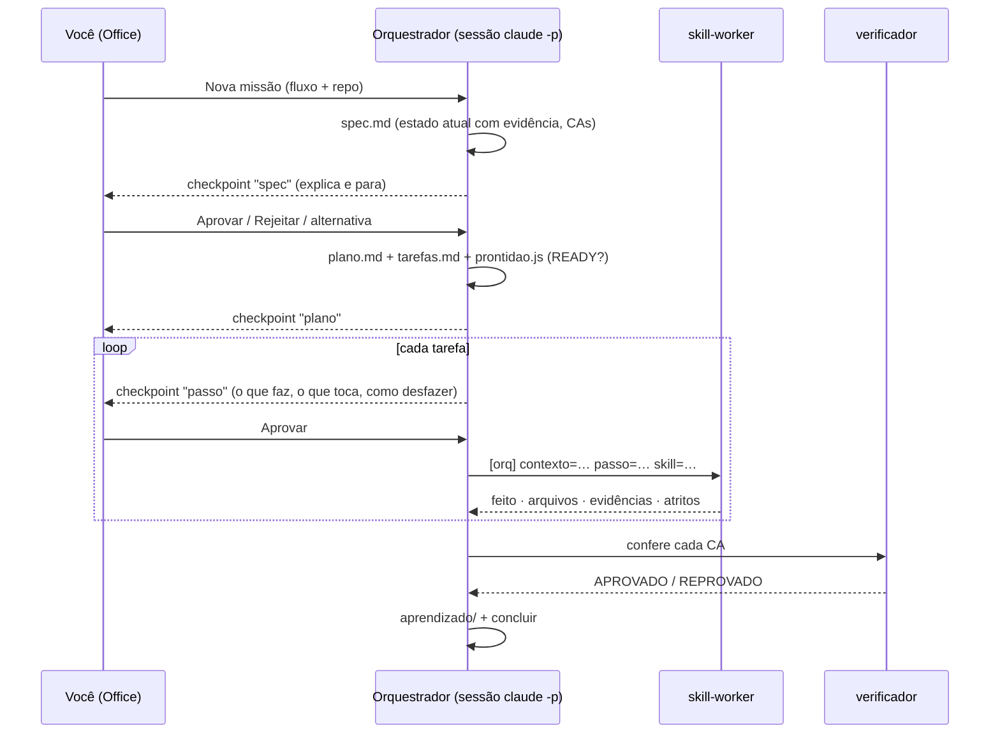
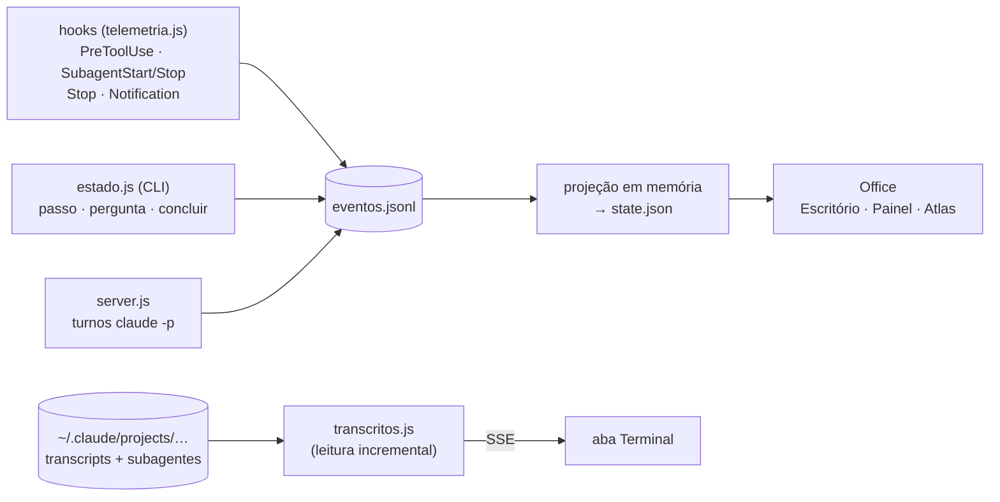

# Yggdrasil: um molde de orquestradores para Claude Code

> Gere, para cada time em que você entrar, um **orquestrador de skills** do Claude Code. Ele conduz cada repositório num ciclo SDD (spec → plano → tarefas → execução → verificação), começa em **modo aprendizado** e mostra tudo num **escritório virtual em pixel art**, onde quem precisa de você levanta a mão e você responde ali mesmo.


<details>
<summary><b>English summary</b></summary>

Yggdrasil is a **template for building Claude Code orchestrators**, one per team. Each generated orchestrator:

- runs a **spec-driven cycle per repository**: spec → plan/tasks → script-based readiness check → execution by `skill-worker` subagents → independent `verificador` → learning log;
- starts in **learning mode**, with manual checkpoints on spec, plan and every step. `/autonomia` measures what you approve without changes and suggests what could become automatic;
- ships a **local web "Office"**, a Gather-like pixel-art office where each repository gets a desk cluster. Agents animate according to the tool they are using, Pixel Agents style. Sub-agents sit next to the agent that spawned them, and whoever needs you raises a hand. You answer from the page, read the live **terminal view** (real Claude Code transcripts, nested sub-agents, diffs, outputs), browse a **panel** of work groups and an **Atlas** mind map of your flows;
- enforces **guardrails as code** through a `PreToolUse` hook that blocks push, MR/PR, `--no-verify`, `rm -rf` outside `repos/`, edits to settings and edits to the team's own skills;
- keeps a **generic core** (this repo) apart from a **team layer** (`time/`), so improvements to the core reach every instance through `scripts/atualizar-nucleo.js`.

No `npm install`: plain Node.js and a dependency-free page. Docs and code are in Brazilian Portuguese.
</details>

---

## Sumário
- [Por que existe](#por-que-existe)
- [O que você ganha](#o-que-você-ganha)
- [Como funciona](#como-funciona)
- [Requisitos](#requisitos)
- [Começo rápido](#começo-rápido)
- [O Office](#o-office)
- [Conceitos](#conceitos)
- [Referência](#referência)
- [Segurança](#segurança)
- [Evoluindo o núcleo](#evoluindo-o-núcleo)
- [Limitações conhecidas e próximos passos](#limitações-conhecidas-e-próximos-passos)
- [Inspirações e créditos](#inspirações-e-créditos)

---

## Por que existe

Entrar num time novo que já tem skills e processos próprios costuma levar a uma de duas situações:
- você automatiza tudo antes de entender o processo, e erra em escala;
- você faz tudo na mão, e não aproveita as skills.

O Yggdrasil propõe um caminho no meio. O orquestrador **segue as skills do time como estão** e **para em cada etapa para explicar** o que vai fazer, por que agora, o que vai tocar e como desfazer. Ele também **mede a sua confiança**: depois de algumas aprovações seguidas sem ajuste, sugere automatizar aquele checkpoint. Você ganha autonomia aos poucos, com rastro de tudo.

O nome vem da árvore que liga os nove mundos da mitologia nórdica: um tronco comum (o núcleo) e um mundo por time (as instâncias).

## O que você ganha

| | |
|---|---|
| **Ciclo SDD por repositório** | spec com evidência `arquivo:linha` → plano e tarefas → *readiness* por script (zero token) → `skill-worker` por tarefa → `verificador` independente → diário e lições |
| **Modo aprendizado** | checkpoints `manual` em spec, plano e cada passo; o `/autonomia` sugere promoções para `auto` (só com o seu ok) |
| **Monitor de contextos** | vários repositórios ao mesmo tempo (`maxContextos`), cada um numa sessão própria do Claude; a caixa de atenção mostra quem espera você |
| **Office (página local)** | Escritório em pixel art, Painel de grupos de trabalho, Mapa Atlas, Conversa, Terminal ao vivo e Decisões |
| **Guardrails como código** | hook `guarda.js` com `permissionDecision: deny` real, não só regra escrita |
| **Telemetria por eventos** | `eventos.jsonl` (append) → `state.json` (projeção). Ninguém edita o estado na mão |
| **Aprendizado com poda** | diário por repo; lições por skill reescritas pelo `/retro` (no máximo ~12, sem repetição) |
| **Molde e instâncias** | `/novo-orquestrador` gera um orquestrador por time; `atualizar-nucleo.js` leva melhorias às instâncias sem tocar no que é do time |
| **Sem dependências** | Node.js puro e página sem CDN; funciona offline e atrás de proxy |

<table>
<tr>
<td width="50%"><b>Baia que cresce com subagentes aninhados</b><br></td>
<td width="50%"><b>Terminal ao vivo, com subagentes aninhados</b><br></td>
</tr>
<tr>
<td><b>Painel de grupos de trabalho</b><br></td>
<td><b>Mapa Atlas (mindmap dos fluxos)</b><br></td>
</tr>
</table>

---

## Como funciona

### Núcleo × camada do time



- **Núcleo**: genérico e igual em todos. Vem do molde e é substituído por inteiro na atualização. A lista exata está em `.claude/nucleo-manifesto.json`.
- **Time** (`time/`): contexto, regras, fluxos, tema e lista das skills do time. Nunca é tocado pela atualização.
- As regras do time **só acrescentam** restrições ao `nucleo.md`, nunca afrouxam.

### Ciclo de um contexto (um repositório, um fluxo)



### De onde vem o que aparece na tela



Cada mudança é um evento. O estado é a projeção dos eventos, recalculada em memória pelo servidor (o `state.json` é gravado em background). O **Terminal** lê direto os transcripts do Claude Code, então mostra qualquer sessão do mesmo jeito: disparada pelo Office, aberta no seu terminal ou levada de um para o outro.

---

## Requisitos

- **Claude Code** (CLI `claude`), numa versão com os hooks `SubagentStart`/`SubagentStop` e com `--permission-mode auto`.
- **Node.js 18 ou mais novo**. Foi desenvolvido e testado no 24.
- **git**.
- Navegador moderno (Chrome, Edge ou Firefox).
- Funciona no Linux, no macOS e no Windows via **WSL2**. Veja as [notas de WSL](#notas-de-wsl).

---

## Começo rápido

### 1. Veja o Office funcionando (sem gastar token)
```bash
git clone https://github.com/reisrb/claude-yggdrasil-orchestrator.git
cd claude-yggdrasil-orchestrator
node .claude/office/server.js --simular --tema nordico
# abra http://localhost:4320
```
O modo `--simular` troca o Claude por um roteiro de eventos falsos. O caminho servidor → eventos → estado → página é o mesmo do modo real. Teste:
- responder e aprovar;
- retomar depois de um limite ou de um erro;
- convocar missões pelo quadro de missões;
- ver o terminal e os subagentes aninhados.

### 2. Crie o orquestrador do seu time
Abra o Claude Code na pasta do molde e rode:
```
/novo-orquestrador
```
A skill entrevista você e gera a instância numa pasta irmã. Ela pergunta:
- nome do orquestrador e do time, e o objetivo do time;
- stacks e ferramentas;
- de onde vêm as skills do time;
- quem aprova o quê e as regras do time;
- tema, número de contextos simultâneos e porta.

Se preferir sem entrevista:
```bash
cat > /tmp/respostas.json <<'EOF'
{
  "nome": "Thor",
  "time": "Plataforma",
  "tema": "nordico",
  "maxContextos": 2,
  "porta": 4321,
  "contexto": {
    "objetivo": "Atualizar serviços e padronizar pipelines",
    "stacks": "Java 17/21, Node 20; Kubernetes",
    "ferramentas": "GitLab, Jira",
    "origemSkills": "repo interno de skills do time",
    "aprovacoes": "tech lead aprova MR"
  },
  "regras": ["Branch sempre a partir de develop"],
  "memoria": ["Começo gradual: um repo por vez, em modo aprendizado"]
}
EOF
node scripts/instanciar.js ../thor /tmp/respostas.json --semear-memoria
```
Com `--semear-memoria`, a memória do Claude Code daquela pasta (`~/.claude/projects/<pasta>/memory/`) já começa com o contexto da entrevista.

### 3. Traga as skills e os fluxos do time
Dentro da instância (`../thor`):
1. Copie as skills do time **sem alterar nada** para `.claude/skills/<skill>/SKILL.md`.
2. Registre cada uma em `time/skills-origem.json`. O `guarda.js` impede que agentes editem essas skills.
3. Descreva os fluxos em `time/fluxos/<id>.json`, com a sequência de passos e qual skill cada passo usa (formato [abaixo](#fluxo-timefluxosidjson)). Não invente passos: um fluxo nasce do processo que o time já usa.

### 4. Rode o primeiro ciclo
```bash
cp -r exemplos/repo-exemplo repos/        # ou: git clone <seu repo> repos/<nome>
```
No Claude Code, dentro da instância:
```
/office                         # sobe o Office em http://localhost:<porta>
/iniciar-fluxo demo repo-exemplo
```
Outra opção: no Office, clique no **quadro de missões** (ou em **＋ Nova missão**), escolha o fluxo e o repo e clique em Convocar. A sessão roda em background com `claude -p`, e cada checkpoint aparece na caixa de atenção.

---

## O Office

`node .claude/office/server.js` (ou `/office`) abre o Office em `http://localhost:<porta>`. Ele tem três visões e um painel lateral.

### Escritório
Visão de cima, em pixel art, desenhada em Canvas e sem nenhuma imagem externa.

- **Baias**: uma por contexto (repositório), com a placa do repo. Elas **crescem** com o número de agentes e não encolhem enquanto o contexto existe.
- **Personagens**:
  - **a líder** é a sessão do orquestrador naquele contexto. No tema nórdico é uma valquíria; os nomes vêm da mitologia, que é domínio público;
  - **os workers** são os subagentes, heróis originais gerados a partir do nome da skill (capa, máscara, emblema e cores);
  - **subagentes que lançam outros** sentam junto do pai, num grupo separado por uma divisória baixa.
- **Animação por atividade real**, inspirada no Pixel Agents:

| A sessão está… | Você vê |
|---|---|
| `Edit` / `Write` | digitando, com código rolando no monitor |
| `Read` / `Grep` / `Glob` | lendo (página ou busca no monitor) |
| `Bash` | rodando (terminal verde no monitor) |
| `Agent` | delegando |
| esperando você | de pé, com a mão levantada e um **!** pulsando |
| limite de uso | dormindo na mesa ("zzz") |
| erro | tela vermelha e fumaça |
| passo concluído | leva ao balcão do verificador e vai para a copa |

- **Elenco fixo do tema nórdico**:
  - **Odin** no trono (Hliðskjálf), mostrando quantos esperam você;
  - **Heimdall** na porta (Bifröst), que levanta o escudo quando o `guarda.js` bloqueia algo;
  - **Forseti** no balcão de verificação;
  - **Huginn e Muninn**, os corvos, que voam com os eventos até o trono;
  - o **poço de Mimir**, onde fica o aprendizado.
  
  O tema `neutro` troca tudo por um escritório comum.
- **Na parede**: o **quadro de missões** convoca contextos e o **quadro branco** abre o Mapa Atlas.
- **Navegação**: roda do mouse dá zoom, arrastar move a vista, duplo clique volta ao normal e clicar num personagem abre a conversa dele.

### Painel
Um cartão por grupo de trabalho:
- a líder no topo, com a atividade atual;
- os subagentes em árvore, ligados pai → filhos;
- pergunta pendente com o botão **Responder**;
- motivo de pausa ou erro;
- lista de concluídos.


### Mapa Atlas
Página própria: um mindmap visto de cima, com o orquestrador no centro e um ramo por fluxo.
- Os passos (skills) ficam ao longo dos ramos, coloridos pelo status agregado dos contextos.
- Cada contexto aparece pendurado no passo em que está.
- Há ramos extras para as ferramentas do orquestrador e para as skills do time que estão fora de fluxo.
- Clicar num nó mostra a descrição da skill e permite convocar uma missão naquele fluxo.

### Painel lateral do contexto
- **Conversa**: a troca resumida com o agente. Quando há decisão, aparece o **cartão de decisão** com:
  - as opções (Aprovar, Rejeitar, Explica melhor ou as alternativas que o agente propôs);
  - o campo **Outra alternativa ou observação**, para escolher uma opção com observação ou mandar uma alternativa sua;
  - **ver detalhes no terminal**.
- **Terminal**: a sessão como no Claude Code, ao vivo por SSE.
  - Cada ferramenta vira um bloco que abre e fecha: comando e saída, arquivo lido, diff de edição.
  - Os subagentes aparecem aninhados no bloco de quem os lançou.
  - **⤢** abre em tela cheia sobre o escritório e mantém a conversa e o cartão de decisão ao lado.
- **Decisões**: o histórico de perguntas e respostas do contexto.
- **Caixa de mensagem**: fala com o agente a qualquer momento.
  - Se ele está perguntando, a mensagem vale como resposta.
  - Se está trabalhando, entra no próximo turno.
  - Se está pausado ou com erro, retoma com a sua instrução.
- **Levar ao terminal**: mostra o `claude --resume <sessão>` para continuar a mesma sessão no seu terminal. O Office marca o contexto como "no terminal" e o Terminal continua espelhando; depois é só devolver.
- **Notificações**: 🔔 ativa a notificação do sistema quando alguém precisa de você e a aba não está visível. 🔊 liga um aviso sonoro. O título da aba mostra quantos estão esperando.

### Parâmetros de URL

| Parâmetro | Efeito |
|---|---|
| `#/painel`, `#/atlas` | abre a visão |
| `?sel=<contextoId>` | abre a conversa de um contexto |
| `?aba=conversa\|terminal\|decisoes` | aba do painel lateral |
| `?zoom=2` | zoom inicial do escritório, centrado na baia em foco |
| `?cheia=1` | terminal em tela cheia |
| `?sse=0` | terminal por polling, em vez de streaming (plano B para proxies) |

---

## Conceitos

### Contexto
Um **contexto** é uma sessão do Claude dedicada a **um repositório e um fluxo**.
- Só existe um contexto ativo por repositório, e no máximo `maxContextos` ao mesmo tempo.
- Status possíveis: `TRABALHANDO`, `PRECISA_DE_VOCE`, `PAUSADO_LIMITE`, `ERRO`, `CONCLUIDO` e `PARADO`.
- **Quem dispara o contexto define como você interage**:
  - **pelo Office**: a sessão roda com `claude -p` e `--resume` a cada turno, e você conversa pela página;
  - **pelo seu terminal**, com `/iniciar-fluxo`: o Office espelha tudo e avisa quando a sessão espera você, mas a resposta é dada no terminal.

### Perguntas e checkpoints
Toda pergunta passa pelo `estado.js`, para aparecer no Office:
```bash
node .claude/office/estado.js pergunta --contexto <id> --tipo checkpoint|duvida|escolha \
  --chave passo:inventario --texto "Posso seguir?" --explicacao "…" --opcoes "Aprovar|Rejeitar|Explica melhor"
```
No turno disparado pelo Office, o agente registra a pergunta e **encerra o turno**: esperar não custa nada. A resposta chega no turno seguinte.

### Modo aprendizado e autonomia
- `orquestrador.json` → `checkpoints` (`spec`, `plano`, `passo`), cada um `manual` ou `auto`, com override por fluxo e passo em `overrides`.
- `node .claude/office/estado.js placar` mostra, por checkpoint, quantas respostas houve e a sequência atual de aprovações sem ajuste.
- `/autonomia` sugere promover para `auto` o que teve 3 ou mais aprovações seguidas sem ajuste. **Só muda a config com o seu ok.**
- Auto mode é outra coisa: o `--permission-mode auto` do Claude Code decide **permissão de ferramenta**, e o modo aprendizado decide **o processo**.

### Papéis
- **Orquestrador (líder do contexto)**: conduz o ciclo, conversa com você e delega.
- **`skill-worker`**: executa **um** passo (uma skill) e nunca verifica o próprio trabalho.
- **`verificador`**: confere os critérios de aceite com evidência e nunca edita.
- **Você**: aprova checkpoints e faz tudo o que é externo (push, MR, merge, deploy, Jira).

### Aprendizado
- **`aprendizado/repos/<repo>.md`**: o diário de cada ciclo, com o que foi feito, atritos, decisões, tempo e custo.
- **`aprendizado/skills/<skill>.md`**: lições curtas que o worker lê antes de executar aquela skill. O `/retro` **reescreve** esse arquivo:
  - poda para no máximo ~12 lições;
  - deduplica e conta quantas vezes cada uma apareceu;
  - separa as lacunas da skill do time, para você levar ao time.

---

## Referência

### Estrutura
```
.claude/
  CLAUDE.md                 # identidade + @nucleo.md + @../time/*.md (na instância)
  nucleo.md                 # constituição genérica
  nucleo-manifesto.json     # o que é núcleo (substituído na atualização)
  settings.json             # defaultMode "auto" + hooks
  agents/                   # skill-worker, verificador
  hooks/                    # guarda.js (deny), telemetria.js (eventos e atividade)
  skills/                   # iniciar-fluxo, office, autonomia, retro, inventario-repo, demo-relatorio
                            # (só no molde: novo-orquestrador)
  office/
    server.js               # servidor local (Node puro)
    estado.js               # lib + CLI do estado (eventos → projeção)
    prontidao.js            # readiness do ciclo (READY|BLOCKED)
    transcritos.js          # leitura incremental dos transcripts do Claude Code
    simulador.js            # modo --simular
    index.html, painel.js, terminal.js, atlas.js, estilo.css
    escritorio/             # motor.js, cena.js, mapa.js, sprites.js, temas/
    state.schema.json       # contrato do estado
time/                       # camada do time (no molde: vazia, com o fluxo demo)
specs/_template/            # spec.md, plano.md, tarefas.md
specs/_nucleo/              # spec e tarefas do próprio núcleo (SDD)
aprendizado/                # diário por repo e lições por skill
exemplos/repo-exemplo/      # repo mínimo para o fluxo demo
repos/                      # clones de trabalho (gitignored)
scripts/                    # instanciar.js, atualizar-nucleo.js, modelos/
```

### `orquestrador.json`
```jsonc
{
  "nome": "Thor", "time": "Plataforma",
  "modo": "aprendizado",                 // aprendizado | autonomo
  "maxContextos": 2,                     // contextos ativos ao mesmo tempo
  "porta": 4321,
  "checkpoints": { "spec": "manual", "plano": "manual", "passo": "manual" },
  "overrides": { "meu-fluxo": { "inventario": "auto" } },
  "modelos": {                           // usados nos turnos disparados pelo Office
    "orquestrador": { "model": "sonnet", "effort": "medium" },
    "worker": { "model": "sonnet", "effort": "medium" },
    "verificador": { "model": "sonnet", "effort": "low" }
  },
  "orcamento": { "maxUsdPorTurno": 2 },  // vira --max-budget-usd
  "gatilho": {
    "habilitado": true,
    "permissionMode": "auto",
    "disallowedTools": ["Bash(git push:*)", "Bash(glab mr:*)", "Bash(gh pr:*)"]
  }
}
```

### Fluxo (`time/fluxos/<id>.json`)
```json
{
  "id": "demo",
  "nome": "Demo: inventário do repositório",
  "missao": "Inventariar um repositório",
  "descricao": "Somente leitura: stack, versões, build, CI e um relatório.",
  "passos": [
    { "id": "inventario", "nome": "Inventário", "skill": "inventario-repo", "papel": "Batedor", "depende": [] },
    { "id": "relatorio", "nome": "Relatório", "skill": "demo-relatorio", "papel": "Cronista", "depende": ["inventario"] }
  ]
}
```
`depende` monta o grafo: dá para ter passos em paralelo. O Mapa Atlas e o quadro de missões leem daqui.

### Tema (`time/tema.json`)
```json
{ "base": "nordico", "herois": { "inventario-repo": { "nome": "Batedora" } } }
```
`base` é um preset de `.claude/office/escritorio/temas/` (`nordico` ou `neutro`). Tudo o que estiver em `tema.json` sobrescreve o preset: nomes dos lugares, elenco, paleta e nomes dos heróis por skill.

### Skills do núcleo
| Skill | Para quê |
|---|---|
| `/iniciar-fluxo <fluxo> <repo>` | o ciclo SDD completo de um repositório |
| `/office [simular]` | sobe o Office em background |
| `/autonomia` | placar de confiança e sugestão de promoções |
| `/retro` | consolida e poda as lições por skill |
| `inventario-repo` | passo genérico, só leitura: stack, versões, build, CI, por evidência |
| `/novo-orquestrador` | (só no molde) entrevista e gera uma instância |

### CLI `estado.js`
```bash
node .claude/office/estado.js contexto criar --repo R --fluxo F        # imprime o id
node .claude/office/estado.js passo --contexto ID --passo P --status ACTIVE|DONE|ERROR [--resumo T]
node .claude/office/estado.js pergunta --contexto ID --tipo checkpoint|duvida|escolha --texto T [--explicacao E] [--opcoes "A|B"] [--chave spec|plano|passo:P]
node .claude/office/estado.js resposta --contexto ID --texto T          # no terminal: registra o que você respondeu
node .claude/office/estado.js worker --contexto ID --resumo T           # resumo exibido na baia
node .claude/office/estado.js contexto concluir --contexto ID [--resumo T]
node .claude/office/estado.js status | placar | projetar | autoteste
node .claude/office/estado.js liberar-guarda 30                         # kill-switch da guarda por 30 min
```

### API HTTP do Office
Escuta só em `127.0.0.1` e `::1`. As rotas `POST` exigem o header `X-Orq-Token`, um token gerado a cada start e injetado na página.

| Método | Rota | O quê |
|---|---|---|
| GET | `/state` | estado + catálogo (skills, agents, fluxos, repos) + tema + config |
| GET | `/contextos/:id/conversa` | conversa resumida |
| GET | `/contextos/:id/terminal` | SSE com as entradas do transcript (`?desde=N` = JSON por polling) |
| POST | `/trigger` | `{fluxoId, repo, nota?}` cria um contexto e inicia o turno |
| POST | `/responder` | `{contextoId, texto}` responde a pergunta aberta |
| POST | `/mensagem` | `{contextoId, texto}` mensagem livre (resposta, fila ou retomada) |
| POST | `/retomar` · `/parar` · `/dispensar` | `{contextoId}` |
| POST | `/terminal` | `{contextoId, valor}` marca ou desmarca "no terminal" e devolve o `claude --resume` |

### Hooks (`.claude/settings.json`)
| Evento | Script | Para quê |
|---|---|---|
| `PreToolUse` (Bash/Edit/Write/…) | `guarda.js` | nega ações proibidas |
| `PreToolUse` (*) | `telemetria.js` | atividade por ferramenta; `worker.inicio` para `Agent` |
| `SubagentStart` / `SubagentStop` | `telemetria.js` | ciclo de vida dos subagentes (inclusive os em background) |
| `PostToolUse(Failure)` (Agent) | `telemetria.js` | fim síncrono ou erro de subagente |
| `Stop` / `Notification` / `UserPromptSubmit` | `telemetria.js` | sessão do terminal esperando você, ou ativa |

---

## Segurança

- O servidor escuta **só no loopback**. Toda escrita exige token e `Origin`/`Host` locais, e fluxos e repos são validados contra o catálogo.
- O `spawn` do `claude` roda sem shell, com o prompt pelo stdin.
- Os turnos disparados pelo Office rodam com:
  - `--permission-mode auto`;
  - `--disallowedTools` para push, MR e PR;
  - `--max-budget-usd` com o teto por turno.
- O **`guarda.js`** nega, de verdade, nas sessões do Office e também nas do seu terminal:
  - `git push`;
  - `glab mr create|merge|approve` e `gh pr create|merge|review`;
  - `--no-verify`;
  - `rm -rf` fora de `repos/`;
  - edição de `.claude/settings*.json`;
  - edição das skills listadas em `time/skills-origem.json`.
  
  Se o próprio hook falhar, ele libera a chamada em vez de travar a sessão. Há kill-switch temporário com `estado.js liberar-guarda`.
- Nunca use `--dangerously-skip-permissions` com este molde: a ideia é o auto mode mais a guarda.

---

## Evoluindo o núcleo

O próprio núcleo segue SDD: `specs/_nucleo/spec.md` traz requisitos e critérios de aceite, e `tarefas.md` mostra o que foi feito e o que falta.

```bash
node .claude/office/estado.js autoteste        # eventos, contextos, perguntas, baias, guarda, limites, concorrência, schema
node .claude/office/prontidao.js --autoteste   # readiness: READY no caso bom, BLOCKED nos ruins
node .claude/hooks/guarda.js --autoteste       # 15 casos de nega/libera + entrada malformada
node .claude/office/server.js --simular        # protótipo visual
```

Para levar uma melhoria às instâncias:
```bash
node scripts/atualizar-nucleo.js ../minha-instancia --dry-run   # mostra o que muda
node scripts/atualizar-nucleo.js ../minha-instancia             # aplica (com tag git de rollback, se houver commit)
```
Só os arquivos do manifesto são substituídos. O `settings.json` é mesclado, unindo os hooks e permissões do molde com os da instância. `time/`, `specs/<repo>/`, `aprendizado/`, `repos/` e as skills do time nunca são tocados.

**Regra do molde:** nada de termos de negócio no núcleo. Nomes de times, sistemas e tickets ficam só em `time/` das instâncias.

### Notas de WSL
- Projetos em `/mnt/c` (disco do Windows visto pelo WSL) têm I/O lento, de 50 a 130 ms por operação. O servidor guarda estado, catálogo, estáticos e conversas em memória e grava em background, então as respostas ficam na casa de dezenas de milissegundos.
- No Windows, `localhost` tenta IPv6 (`::1`) primeiro, e o servidor também escuta em `::1` para evitar 2 s de espera. O primeiro acesso depois de reiniciar o servidor pode demorar uns segundos, por causa do aquecimento da ponte do WSL.
- Os transcripts do Claude Code ficam em `~/.claude/projects/` (disco do Linux), então a leitura do Terminal é rápida.

---

## Limitações conhecidas e próximos passos

**Limitações**
- **O Office não digita numa sessão interativa aberta no seu terminal.** O Claude Code não oferece isso. Para conversar pela página, a sessão precisa ter sido disparada pelo Office; as sessões do terminal são espelhadas só para leitura. Dá para alternar com **Levar ao terminal** e `claude --resume`.
- Nas sessões do Office, sua mensagem entra **entre turnos**: se ele estiver no meio de um turno, ela vai para a fila.
- O custo exibido é o **acumulado da sessão** que o Claude Code reporta.
- Os sprites são feitos em código, com cara de 16-bit simples. Dá para trocar por um pacote de arte CC0 sem mexer na lógica.
- O escritório comporta duas linhas de baias. Contextos além disso aparecem no Painel e na caixa de atenção.

**Próximos passos**
- Modo passeio: um avatar seu andando pelo WASD, que abre a conversa ao chegar perto de um herói.
- Ondas de repositórios em paralelo, cada um em worktree ou clone próprio.
- Editor de layout do escritório e mais temas.
- Pacote de arte CC0 opcional.

---

## Inspirações e créditos

- **[claude-didio-config](https://github.com/eduardodidio/claude-didio-config)**: um `claude -p` por agente, estado projetado a partir de logs, readiness antes de executar e retrospectiva que vira aprendizado. Aqui as ideias foram adaptadas: readiness por script, lições com poda, guardrails como hook e Node puro.
- **[Pixel Agents](https://github.com/pablodelucca/pixel-agents)**: personagens em pixel art animados pela ferramenta que a sessão está usando, com subagentes como personagens ligados ao pai.
- **Gather**: o conceito de escritório virtual visto de cima.
- **Mitologia nórdica** (domínio público): Odin, Heimdall, Forseti, Huginn e Muninn, Mimir, Hliðskjálf, Bifröst, valquírias. Todos os heróis e sprites são **originais**, gerados em código, sem personagens de nenhuma franquia.

## Licença

A definir pelo autor. Até lá, todos os direitos reservados. Se for publicar para outras pessoas usarem, uma opção comum é MIT.
